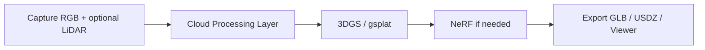

# ScanBox AI

ScanBox AI is a modular 3D digitization project for turning raw capture data into usable digital assets for e-commerce, AR preview, and later engineering-grade workflows.

## Documents
- `technical-document.md` — core technical specification
- `architecture.md` — system architecture and data flow
- `research-nerf.md` — NeRF research notes
- `research-3dgs.md` — 3D Gaussian Splatting research notes
- `research-lidar-fusion.md` — LiDAR / point cloud fusion research notes

## Quick flow

## Working principle
- capture RGB + optional LiDAR / depth data
- reconstruct with 3DGS as the default MVP path
- keep NeRF as the advanced quality mode
- use Cloud Processing Layer for heavy jobs when needed

## Current focus
The current documentation set covers architecture, reconstruction choices, and LiDAR integration. The next step is to expand the roadmap and open questions into a more product-oriented plan.

## Cloud Run GPU backend

See [cloud_run/README.md](cloud_run/README.md) for the Cloud Run GPU assessment,
private job creation/status/cancellation API, GCS worker, deployment scripts,
cost estimate, and local tests. The existing Selectel demo remains available.

## Selectel preemptible GPU test

See [selectel-preemptible.md](selectel-preemptible.md) for Selectel preemptible
VM support and a lifecycle smoke test: create, verify the tag/GPU, and delete
the VM, boot volumes, and temporary keypair.

Docker runner and GPU worker commands are documented in [docker/README.md](docker/README.md),
with separate Compose files for the local control plane and GPU VM.
