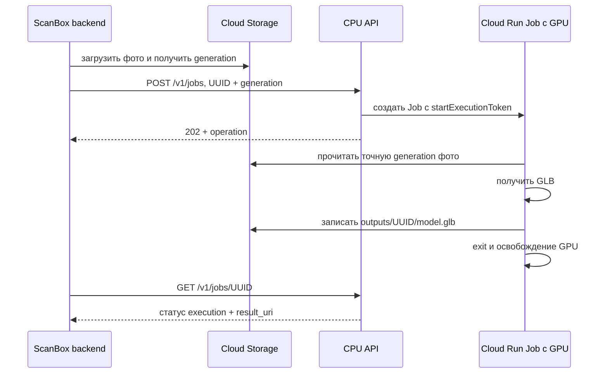

# ScanBox AI: эфемерный GPU в Google Cloud Run

## Решение

Для существующего MVP «одно фото → GLB» рекомендован **Cloud Run Job**.
Каждый запрос создаёт Job `sb-<UUID>` и одну Execution с GPU. Контейнер
читает фото из GCS, записывает GLB в GCS и выходит. CPU API работает отдельно
и может масштабироваться до нуля. SSH, cloud-init и удаление VM не нужны.

Это дополнительный backend: `api/app.py`, очередь в памяти и Selectel-оркестратор
не изменены. Новый API предназначен для доверенного backend ScanBox, а не для
прямого доступа из публичного браузера. Авторизация — Cloud Run IAM.

Проверка документации: 3 ноября 2026. Возможности и квоты необходимо сверить
перед первым запуском именно в вашем проекте.

| Вариант | Применение к ScanBox |
| --- | --- |
| Cloud Run Job с GPU | Выбран для конечной batch-задачи, результат хранится отдельно |
| Cloud Run Service с GPU | Подходит для повторного inference с моделью в памяти; есть холодный старт и оплачиваемое время жизни инстанса |
| GPU VM / GKE / Batch | Рассмотреть для multi-GPU, специфических системных зависимостей, больших локальных данных и длительного обучения |

Факты платформы: один GPU на контейнерный инстанс; L4 — 24 GB VRAM,
минимум 4 vCPU / 16 GiB RAM. Для MVP выбраны L4, 8 vCPU / 32 GiB,
`europe-west4`, без зональной избыточности. Документация также описывает
RTX PRO 6000 Blackwell с 96 GB VRAM и минимумом 20 vCPU / 80 GiB RAM;
для него потребуется отдельный профиль ресурсов и совместимый ML-образ.
Документированные ~5 секунд запуска GPU не включают загрузку весов и инициализацию модели.
Источник: [GPU для Jobs](https://docs.cloud.google.com/run/docs/configuring/jobs/gpu).

Таймаут здесь ограничен **3600 секундами**, по умолчанию 1800; одна задача,
без автоматических повторов. Документация timeout уже описывает 12 часов для GPU
в preview, тогда как best practices рекомендуют ≤1 часа. Эта реализация
не зависит от preview. Для длительных 3DGS/NeRF-задач нужны checkpoints в GCS
и отдельный выбор платформы.
Источники: [таймаут](https://docs.cloud.google.com/run/docs/configuring/task-timeout),
[рекомендации для GPU Jobs](https://docs.cloud.google.com/run/docs/configuring/jobs/gpu-best-practices).

## Ограничение модели

Tencent указывает для Hunyuan3D-2.1 около 10 GB VRAM на shape, 21 GB на texture
и 29 GB на совместный цикл. Поэтому полный pipeline нельзя обещать на L4.
В `worker.py` подготовлен адаптер **hunyuan-shape**, выдающий геометрию без PBR-текстур.
Для texture можно исследовать раздельные стадии/offload или Blackwell.
Фактические время и пиковую память необходимо измерить на целевом GPU.
Источник: [официальный Hunyuan3D-2.1](https://github.com/Tencent-Hunyuan/Hunyuan3D-2.1).

`mock` возвращает валидный GLB с пустой сценой и нужен только для проверки
инфраструктуры. Даже mock Job в облаке выделяет GPU и оплачивается.
Ошибка реального движка никогда не подменяется mock-результатом.

## Состав

- `app.py` — FastAPI: создание, статус, отмена и удаление Job; `/docs`, `/openapi.json`.
- `control.py` — Cloud Run Admin REST v2 через ADC; фиксированные образ и service account.
- `worker.py` — GCS → shape/mock → проверка GLB → GCS → exit.
- `Dockerfile.api`, `Dockerfile.worker`, `cloudbuild.*.yaml` — сборка двух образов.
- `deploy.sh` — GCS, Artifact Registry, IAM, сборка и закрытый CPU-сервис API.
- `cleanup.py` — удаление старых завершённых Job; по умолчанию только список кандидатов.
- `tests/` — локальные проверки без обращения к Google Cloud и без GPU.



## Подготовка GCP и развертывание

Нужны billing-enabled project, актуальный `gcloud`, Python 3, права на включение
API, IAM/service accounts, создание bucket/repository, сборку и Cloud Run deployment.
Исполнитель deployment должен иметь `iam.serviceAccounts.actAs` на двух создаваемых SA.
Cloud Build identity должна иметь доступ к source bucket, запись в Artifact Registry
и логирование. Конкретная build identity зависит от настроек вашего проекта;
не предполагается, что default compute SA уже имеет Editor.
Проверьте региональную квоту Cloud Run GPU без зональной избыточности.

Из корня репозитория:

```bash
export GOOGLE_CLOUD_PROJECT='YOUR_PROJECT_ID'
export CLOUD_RUN_REGION='europe-west4'
export SCANBOX_BUCKET='YOUR_GLOBALLY_UNIQUE_BUCKET'
export SCANBOX_CALLER='user:YOU@example.com'
export SCANBOX_ENGINE='mock'
bash cloud_run/deploy.sh
```

Скрипт выполняет реальные платные операции только при ручном запуске. Он
создаёт CPU API, а GPU появляется при `POST /v1/jobs`. Имя bucket должно
принадлежать вашему проекту; при повторном использовании существующего bucket
заранее проверьте регион, uniform bucket access и запрет публичного доступа.
Для эксплуатации используйте `serviceAccount:BACKEND_SA_EMAIL` как caller.
Если Cloud Run Service с этим именем уже существует, убедитесь, что у него
нет старых IAM-привязок `allUsers`/`allAuthenticatedUsers`.

Worker SA читает только `inputs/` и создаёт объекты только в `outputs/`.
Control SA получает отдельную custom role для Jobs и actAs только на Worker SA.
Роль контроллера выдана на проект: используйте отдельный project для GPU backend,
если нужна строгая изоляция от других workloads. Control SA не читает фото.

Контейнеры запускаются непривилегированно. Сборка worker фиксируется по digest
в конфигурации API; публичный клиент не выбирает образ, команды, SA или GPU-профиль.

### Реальный ML-образ

Default `Dockerfile.worker` содержит только инфраструктуру и mock.
Для реальной генерации нужен **проверенный базовый ML-образ**, содержащий:

1. Python, CUDA-совместимый PyTorch и зависимости shape-части Hunyuan3D-2.1.
   Tencent описывает Python 3.10 / PyTorch 2.5.1+cu124 как проверенную комбинацию.
2. `hy3dshape` в Python path, PIL, trimesh, требуемые моделью encoder-зависимости.
3. Shape-веса и config в `/opt/models/Hunyuan3D-2.1/hunyuan3d-dit-v2-1`,
   safetensors-вариант и все вспомогательные encoder-веса в локальном кеше.
4. Права чтения этих файлов для UID 65532. При необходимости задайте
   `SCANBOX_MODEL_PATH` через `ENV` базового образа.

Код адаптера использует официальный Python pipeline API вместо неподтверждённой
команды `run.py` из старого `scripts/generate.py`. Перед эксплуатацией
зафиксируйте commit upstream и версии зависимостей в ML-образе и проверьте
его на L4. Веса загружаются при сборке/подготовке образа; runtime работает offline.
Вход желательно подготовить как RGBA с удалённым фоном; сегментация в адаптер не включена.

```bash
export SCANBOX_ENGINE='hunyuan-shape'
export SCANBOX_BASE_IMAGE='REGION-docker.pkg.dev/PROJECT/REPO/hunyuan-shape@sha256:YOUR_DIGEST'
bash cloud_run/deploy.sh
```

Полный PBR, multi-view reconstruction и 3DGS/NeRF не реализованы этим адаптером.
Они потребуют других worker-образов и контрактов входных данных.

## Вызов API

Входной объект: `gs://BUCKET/inputs/<UUID_HEX>/photo.png`.
Выход: `gs://BUCKET/outputs/<UUID_HEX>/model.glb`.
Backend, загружающий фото и скачивающий модель, должен отдельно получить GCS-права.
Токены и ключи не передаются в JSON.

```bash
export SCANBOX_API_URL='https://YOUR_CLOUD_RUN_SERVICE_URL'
JOB_ID="$(python3 -c 'import uuid; print(uuid.uuid4().hex)')"
gcloud storage cp ./photo.png "gs://${SCANBOX_BUCKET}/inputs/${JOB_ID}/photo.png" --if-generation-match=0
INPUT_GENERATION="$(gcloud storage objects describe "gs://${SCANBOX_BUCKET}/inputs/${JOB_ID}/photo.png" --format='value(generation)')"
# Для локальной разработки под Google user account:
TOKEN="$(gcloud auth print-identity-token)"
curl --fail-with-body -X POST "${SCANBOX_API_URL}/v1/jobs" \
  -H "Authorization: Bearer ${TOKEN}" -H 'Content-Type: application/json' \
  -d "{\"job_id\":\"${JOB_ID}\",\"input_generation\":${INPUT_GENERATION},\"extension\":\"png\",\"timeout_seconds\":1800}"
curl --fail-with-body "${SCANBOX_API_URL}/v1/jobs/${JOB_ID}" -H "Authorization: Bearer ${TOKEN}"
# После status=succeeded:
gcloud storage cp "gs://${SCANBOX_BUCKET}/outputs/${JOB_ID}/model.glb" ./model.glb
```

Сервисный backend получает OIDC ID token с audience, равной URL API, через
service identity/ADC, и передаёт его в Authorization Bearer.
Для локального запуска API без IAM-прокси используйте только доверенный localhost:

```bash
python3 -m pip install -r cloud_run/requirements.txt
# Также задайте SCANBOX_WORKER_IMAGE и SCANBOX_WORKER_SA; настройте ADC.
uvicorn cloud_run.app:app --host 127.0.0.1 --port 8080
```

| Метод | Назначение |
| --- | --- |
| `POST /v1/jobs` | Создать и начать одну задачу; вернуть 202 без ожидания GPU |
| `GET /v1/jobs/{uuid}` | `provisioning`, `running`, `succeeded`, `failed`, `cancelled`; исходные условия Google доступны в ответе |
| `POST /v1/jobs/{uuid}:cancel` | Запросить отмену; она асинхронна, продолжать polling |
| `DELETE /v1/jobs/{uuid}` | Удалить завершённый Job или Job с ошибкой provisioning; данные GCS сохраняются |

Валидация неправильного запроса даёт 422, отсутствующий Job — 404, конфликт — 409,
квота/rate limit — 429, прочие ошибки Google — 502.
Если отмена пришла до создания Execution, возвращается 409: повторите после polling.

### Повторы, сбои и очистка

Сохраняйте `job_id` в основной БД ScanBox **до** вызова API. При timeout/5xx
повторяйте тот же POST с теми же параметрами и backoff. Cloud Run создаёт
Job с `startExecutionToken=initial`, без отдельного неидемпотентного `jobs.run`.
Существующий Job с тем же fingerprint возвращается как `reused=true`,
с другими параметрами — 409. После повторного deployment с другим worker digest
или engine старые POST также дадут 409; проверяйте прежнюю задачу через GET.
Не удаляйте Job до окончания окна повторов: после удаления повторный POST может
создать новое выполнение. Для повторной генерации используйте новый UUID.
Источник: [Job REST resource и execution tokens](https://docs.cloud.google.com/run/docs/reference/rest/v2/projects.locations.jobs).

Generation входного объекта фиксируется; не перезаписывайте и не удаляйте его
до завершения. Выход записывается с `if_generation_match=0`, что исключает
тихую перезапись. Exit code worker определяет статус Execution, включая
OOM, истечение timeout и SIGTERM. При резком завершении JSON со статусом
не нужен — источник истины Cloud Run. Результат доступен после успешной загрузки.

GPU освобождается после окончания Execution; пустая конфигурация Job его не удерживает.
Запись Job автоматически этим приложением не удаляется. Под теми же env и ADC:

```bash
python3 -m cloud_run.cleanup --days 7
python3 -m cloud_run.cleanup --days 7 --apply
```

Назначьте housekeeping по своему расписанию. Отдельно задайте срок хранения
фотографий/GLB через GCS lifecycle согласно требованиям проекта.
API не ставит глобальный лимит параллельных GPU: `parallelism=1` относится к одному
Job. На старте ограничьте GPU-квоту и число допускаемых задач на стороне backend;
для публичного продукта добавьте общую очередь/admission control, tenant ownership
и ограничения пользователя. Доступ IAM сейчас предполагает доверенный backend.

## Оценка стоимости

Пример по опубликованным USD-тарифам **us-central1**, без скидок/free tier:
L4 $0.0001867/s + 8 CPU × $0.000018/s + 32 GiB × $0.000002/s
≈ **$1.42/час**, 5 минут ≈ $0.118, 30 минут ≈ $0.710.
Jobs оплачиваются за время жизни инстанса, минимум одну минуту.
Это иллюстрация вычислительной части, не подтверждённая цена europe-west4:
добавляются cold start/загрузка модели, CPU API, хранение, операции GCS,
Artifact Registry, Cloud Build, логи и трафик.
Источник: [официальные цены Cloud Run](https://cloud.google.com/run/pricing).

## Проверки и что ещё нужно

```bash
python3 -m unittest discover -s cloud_run/tests -v
bash -n cloud_run/deploy.sh
```

Локальные проверки покрывают ASGI-контракт API, создание и повторы, смену input
generation, запрет удаления работающей задачи, отмену, чужие Job, ошибки worker,
ограничение размера, валидность GLB и запрет перезаписи результата.
Google SDK/Cloud Run/GCS в этих проверках подменены. Облачный deployment,
реальный IAM и ML inference здесь не выполнялись; интеграционный тест ещё нужен.

Для пилота нужны project ID, выбранный регион и GPU-квота, caller identity,
решение shape/PBR и доступный ML-образ с весами. После этого выполнить один
mock job для инфраструктуры, один shape job на реальном фото, измерить cold start,
пиковую VRAM/RAM, полную стоимость и качество GLB.
